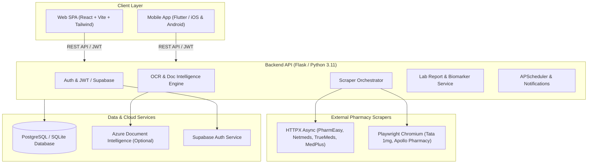

# 🩺 MedScan — Medicine Price Comparison & Healthcare Intelligence Platform

> **Live multi-storefront scraping, OCR prescription extraction, lab report biomarker analysis, and medication adherence tracking for India.**

MedScan is a comprehensive healthcare platform built for the Indian pharmaceutical ecosystem. It provides real-time price comparison across top Indian online storefronts, prescription parsing via intelligent OCR, automated lab report biomarker evaluation, Jan Aushadhi generic alternative suggestions, scheduled medication reminders, and a cross-platform web and mobile client experience.

---

## 📑 Table of Contents

- [Key Features](#-key-features)
- [Architecture Overview](#-architecture-overview)
- [Directory Structure](#-directory-structure)
- [Tech Stack](#-tech-stack)
- [Prerequisites](#-prerequisites)
- [Environment Configuration](#-environment-configuration)
- [Local Development Setup](#-local-development-setup)
  - [1. Backend API (Flask)](#1-backend-api-flask)
  - [2. Web Frontend (React + Vite)](#2-web-frontend-react--vite)
  - [3. Mobile Application (Flutter)](#3-mobile-application-flutter)
  - [4. Docker Setup](#4-docker-setup)
- [API Reference](#-api-reference)
- [Deployment Guide (Azure & CI/CD)](#-deployment-guide-azure--cicd)
- [Legal & Medical Disclaimer](#-legal--medical-disclaimer)

---

## ✨ Key Features

### 🛒 Real-Time Medicine Price Comparison
* **12+ Live Storefront Scrapers**: Simultaneously searches leading Indian online pharmacies:
  * **HTTPX Async Pipelines**: PharmEasy, Netmeds, TrueMeds, MedPlus.
  * **Headless Chromium (Playwright)**: Tata 1mg, Apollo Pharmacy.
* **No Fabricated Data**: Performs live extraction for normalized queries, returning direct product links, total pricing, unit prices (per tablet/capsule), and availability.
* **Resilient Concurrency**: Fault-tolerant execution with per-pharmacy error handling and graceful `502 Bad Gateway` reporting when all storefronts fail.

### 📄 Prescription OCR & Intelligent Extraction
* **Multi-Format Processing**: Supports image (`.jpg`, `.png`) and document (`.pdf`) uploads.
* **Hybrid OCR Engine**:
  * **Images**: Preprocessed with OpenCV + Tesseract OCR / RapidOCR.
  * **PDFs**: Text extraction via PyMuPDF (`fitz`) / `pdfplumber` with automatic fallback to first-page rasterization & OCR.
  * **Cloud Fallback**: Azure Document Intelligence (`prebuilt-read`) when enabled.
* **Rule-Based & LLM Extraction**: Extracts medicine names, dosages, frequencies, and durations with validation against an internal catalog.

### 🧪 Lab Report Analyzer & Biomarker Insights
* **Biomarker Parsing**: Automatically scans lab reports for parameters such as Hemoglobin, Blood Sugar (HbA1c / Fasting), Cholesterol levels, Thyroid profiles (TSH/T3/T4), Liver Function (ALT/AST), and Kidney Function (Creatinine/Urea).
* **Reference Interval Comparison**: Evaluates values against clinical baseline intervals locally without relying on external LLM APIs.

### 💊 Jan Aushadhi & Generic Substitutes
* **Cost Savings Discovery**: Matches branded drugs with low-cost generic alternatives under the Pradhan Mantri Bhartiya Janaushadhi Pariyanjana (PMBJP) scheme.

### ⏰ Reminders & Adherence Tracking
* **Scheduled Notifications**: Background job scheduling via `APScheduler` for dosage alerts.
* **Adherence Dashboard**: Log daily medication doses, calculate adherence percentages, and track health streaks.

### 🤖 AI & Rule-Based Healthcare Assistant
* **Contextual FAQ Assistant**: Instant support at `/api/chatbot` covering medicine search, dosage queries, prescription processing, lab report analysis, and app features.

### 📱 Multi-Platform Access
* **Web Client**: Responsive React SPA built with Vite & Tailwind CSS.
* **Mobile App**: Cross-platform Flutter app (`iOS` & `Android`) featuring native auth, offline state caching, and mobile UI integration.

---

## 🏗 Architecture Overview



---

## 📁 Directory Structure

```text
MediScan/
├── .github/
│   └── workflows/
│       ├── deploy-backend.yml      # CI/CD: Azure App Service deployment
│       └── deploy-frontend.yml     # CI/CD: Azure Static Web Apps deployment
├── backend/
│   ├── app/
│   │   ├── models/                 # SQLAlchemy DB models (User, Medicine, Prescription, Reminder, etc.)
│   │   ├── routes/                 # Flask Blueprints (Auth, Medicine, Prescription, Reminders, Reports, etc.)
│   │   ├── scheduler/              # APScheduler background tasks
│   │   ├── services/               # Scraper, OCR, NLP, Biomarker & LLM services
│   │   ├── utils/                  # Catalog seeding, logger, rate-limiting, SQLite patch
│   │   ├── config.py               # Flask Base, Development & Production configs
│   │   └── __init__.py             # Application factory & middleware initialization
│   ├── migrations/                 # Alembic database migration scripts
│   ├── Dockerfile                  # Playwright-enabled backend container
│   ├── requirements.txt            # Python dependencies
│   └── run.py                      # Development server entry point
├── frontend/
│   ├── src/
│   │   ├── components/             # Reusable UI components & navigation
│   │   ├── pages/                  # React pages (Dashboard, Compare, Scan, Reminders, Lab Reports, etc.)
│   │   ├── services/               # Axios API client & endpoints
│   │   └── store/                  # Application state management
│   ├── Dockerfile                  # Nginx production frontend container
│   ├── package.json                # React dependencies and scripts
│   └── vite.config.js              # Vite build setup & dev proxy
├── mobile/
│   ├── lib/
│   │   ├── core/                   # Mobile API client, theme & constants
│   │   ├── features/               # Flutter features (Auth, Search, Compare, Prescription, Reminders)
│   │   ├── providers/              # Riverpod / Provider state providers
│   │   └── main.dart               # Flutter application entry point
│   ├── pubspec.yaml                # Flutter packages & assets declaration
│   └── README.md                   # Dedicated mobile guide
├── docs/
│   ├── API_KEYS.md                 # Environment secrets reference
│   ├── SUPABASE_AUTH.md            # Supabase integration setup
│   └── azure-deployment.md         # Full Azure Cloud deployment manual
├── scripts/                        # Utility maintenance scripts
├── docker-compose.yml              # Multi-container orchestration (Backend + Frontend)
├── .env.example                    # Global environment variables template
└── README.md                       # Main project documentation
```

---

## 🛠 Tech Stack

| Component | Framework / Library | Description |
| :--- | :--- | :--- |
| **Backend Framework** | Flask (Python 3.11) | Application factory, RESTful Blueprints, CORS middleware |
| **Database & ORM** | PostgreSQL / SQLite + SQLAlchemy | Alembic migrations, database models & relationship mapping |
| **Scraping Engine** | Playwright & HTTPX | Async browser rendering, stealth headers, API interception |
| **OCR & Vision** | OpenCV, Tesseract, PyMuPDF, Azure DI | Document preprocessing, PDF rasterization & OCR extraction |
| **Auth & Security** | Flask-JWT-Extended & Supabase Auth | Secure bearer authentication, token refresh & client API key guard |
| **Scheduling** | APScheduler | Background job execution for reminders & adherence alerts |
| **Web Frontend** | React 18, Vite, Tailwind CSS | Modern responsive single page interface |
| **Mobile Frontend** | Flutter / Dart | Native cross-platform app for iOS and Android |
| **Container & Cloud** | Docker, Azure App Service, SWA | Containerized backend & static web frontend hosting |

---

## 📋 Prerequisites

Before running MedScan locally, ensure you have the following installed on your machine:

- **Python**: Version `3.11+`
- **Node.js**: Version `20+` and `npm`
- **Flutter SDK** (Optional, for mobile app): `3.x+`
- **Tesseract OCR**: Installed on system `PATH` (or specified via `TESSERACT_CMD` environment variable).
- **Chromium for Playwright**: Installed via Python module.

---

## ⚙️ Environment Configuration

Create a `.env` file in the project root (or inside `backend/` and `frontend/`) using `.env.example`:

```bash
# Flask & Database
FLASK_ENV=development
SECRET_KEY=dev-secret-key-change-in-production
DATABASE_URL=sqlite:///medscan.db

# JWT Configuration
JWT_SECRET_KEY=jwt-secret-key-change-in-production
JWT_ACCESS_MINUTES=15
JWT_REFRESH_DAYS=7

# OCR Settings
TESSERACT_CMD=C:\Program Files\Tesseract-OCR\tesseract.exe # Windows path if applicable
AZURE_DOCUMENT_INTELLIGENCE_ENDPOINT=
AZURE_DOCUMENT_INTELLIGENCE_KEY=
MEDSCAN_AZURE_OCR=0

# Scraper Settings
SCRAPER_CONCURRENCY=6
SCRAPER_TIMEOUT_SECS=120
SCRAPER_PROXY_URL=

# Supabase Auth (Optional)
SUPABASE_URL=https://your-project.supabase.co
SUPABASE_ANON_KEY=your-supabase-anon-key
SUPABASE_JWT_SECRET=your-supabase-jwt-secret

# Frontend Configuration (frontend/.env)
VITE_API_URL=http://127.0.0.1:5000
```

---

## 🚀 Local Development Setup

### 1. Backend API (Flask)

```bash
# Navigate to backend directory
cd backend

# Create and activate a virtual environment
python -m venv venv
# On Windows: venv\Scripts\activate
# On macOS/Linux: source venv/bin/activate

# Install dependencies
pip install -r requirements.txt

# Install Playwright Chromium browser binary
python -m playwright install chromium

# Run the Flask development server (runs on http://127.0.0.1:5000)
python run.py
```

### 2. Web Frontend (React + Vite)

```bash
# Navigate to frontend directory
cd frontend

# Install Node dependencies
npm install

# Start Vite development server (runs on http://localhost:5173 with proxy to /api)
npm run dev
```

### 3. Mobile Application (Flutter)

```bash
# Navigate to mobile directory
cd mobile

# Get Flutter dependencies
flutter pub get

# Run on connected device or emulator
flutter run
```

### 4. Docker Setup

To bring up the entire environment (Flask backend with Playwright + React frontend via Nginx) using Docker Compose:

```bash
docker compose up --build
```

Access the application:
- **Frontend SPA**: `http://localhost:5173`
- **Backend API**: `http://localhost:5000`
- **Health Check**: `http://localhost:5000/api/health`

---

## 📡 API Reference

| Endpoint | Method | Description | Auth Required |
| :--- | :---: | :--- | :---: |
| `/health` or `/api/health` | `GET` | Health check & system capability diagnosis (OCR, scrapers) | ❌ |
| `/api/auth/signup` | `POST` | Register a new user account | ❌ |
| `/api/auth/login` | `POST` | User login & JWT issue | ❌ |
| `/api/search-medicine` | `GET` | Live multi-pharmacy price comparison search | ❌ / 🔑 |
| `/api/compare` | `POST` | Compare multiple medicine pricing results | ❌ / 🔑 |
| `/api/upload-prescription` | `POST` | Upload prescription image/PDF for OCR text extraction | 🔑 |
| `/api/upload-lab-report` | `POST` | Upload lab report document for biomarker parsing | 🔑 |
| `/api/reminders` | `GET / POST` | Fetch or create scheduled medication reminders | 🔑 |
| `/api/adherence` | `GET / POST` | Log medication intake & view adherence statistics | 🔑 |
| `/api/chatbot` | `POST` | Send query to rule-based healthcare assistant | ❌ / 🔑 |
| `/api/dashboard` | `GET` | Retrieve user dashboard stats, summary, and reminders | 🔑 |
| `/api/nearby-pharmacies` | `GET` | Find local pharmacies by GPS / geolocation coordinates | 🔑 |

---

## ☁️ Deployment Guide (Azure & CI/CD)

MedScan is optimized for **Microsoft Azure**:

| Component | Azure Service |
| :--- | :--- |
| **Backend API** | Azure App Service (Linux Docker container) |
| **Frontend SPA** | Azure Static Web Apps |
| **Database** | Azure Database for PostgreSQL (Flexible Server) |
| **Container Registry** | Azure Container Registry (ACR) |

### Deployment Quickstart

```bash
# 1. Build and push backend image to ACR
cd backend
az acr build --registry acrmedscan --image medscan-api:latest --file Dockerfile .

# 2. Deploy frontend to Azure Static Web Apps
cd ../frontend
npm run build
swa deploy ./dist --env production
```

Detailed deployment configurations, capacity planning, and cost estimation guides are available in **[`docs/azure-deployment.md`](docs/azure-deployment.md)**.

---

## ⚖️ Legal & Medical Disclaimer

> **Disclaimer**: MedScan is an informational tool designed for price comparison and document management. It does **not** provide medical advice, diagnosis, or treatment recommendations. Always consult a qualified healthcare professional regarding prescription medications or medical conditions.
> 
> *Scraping third-party online pharmacy storefronts must comply with local laws and terms of service. Ensure legal and regulatory compliance prior to production deployment.*
