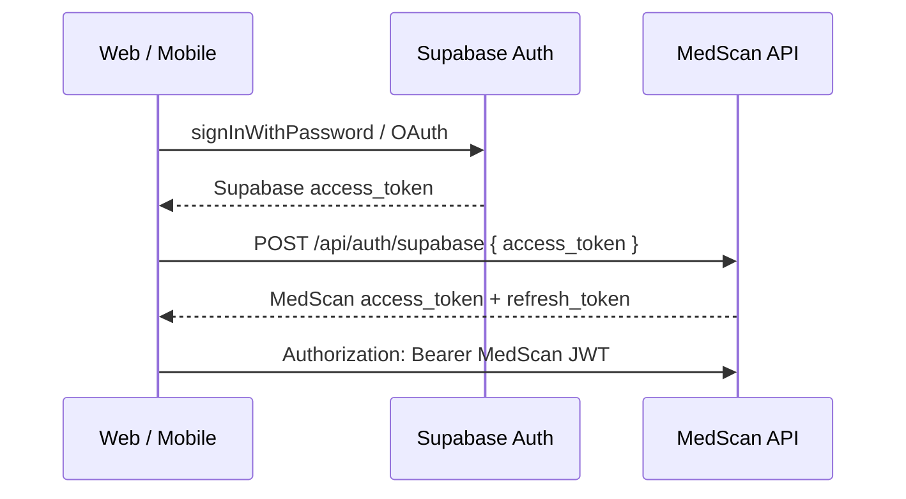

# Supabase authentication

MedScan can use **[Supabase Auth](https://supabase.com/docs/guides/auth)** for sign-up, sign-in, Google OAuth, and password reset. Your Flask API still issues **MedScan JWTs** for `/api/*` so reminders, prescriptions, and scrapers keep working unchanged.

## Architecture



- **Supabase** stores users and handles passwords / OAuth.
- **MedScan `users` table** links `supabase_id` → local `id` for your data.
- **Web and mobile** both use Supabase Auth exclusively. The legacy `/api/auth/login` / `register` endpoints have been removed.

## 1. Create a Supabase project

1. [supabase.com](https://supabase.com) → New project.
2. **Authentication → Providers**: enable Email; enable Google if needed (add Google OAuth client in Supabase).
3. **Authentication → URL configuration**:
   - Site URL: `http://localhost:5173` (dev) and your production SWA URL.
   - Redirect URLs: `http://localhost:5173/auth/callback`, `https://YOUR-SWA.azurestaticapps.net/auth/callback`.
4. **Project Settings → API**:
   - `Project URL` → `SUPABASE_URL` / `VITE_SUPABASE_URL`
   - `anon` `public` key → `SUPABASE_ANON_KEY` / `VITE_SUPABASE_ANON_KEY`
5. **Project Settings → API → JWT Settings**:
   - `JWT Secret` → `SUPABASE_JWT_SECRET` (backend only — never ship to mobile as JWT secret; mobile uses anon key only)

## 2. Backend (`medscan/backend/.env`)

```env
SUPABASE_URL=https://xxxx.supabase.co
SUPABASE_ANON_KEY=eyJ...
SUPABASE_JWT_SECRET=your-jwt-secret-from-dashboard
```

Restart Flask. Optional check:

```bash
curl http://127.0.0.1:5000/api/auth/supabase/config
```

## 3. Web (`medscan/frontend/.env`)

```env
VITE_SUPABASE_URL=https://xxxx.supabase.co
VITE_SUPABASE_ANON_KEY=eyJ...
```

When both are set, Login / Signup / Forgot password use Supabase automatically.

## 4. Mobile (Flutter)

Mobile uses the **same Supabase Auth flow as web**: email/password or Google OAuth → Supabase session → `POST /api/auth/supabase` → MedScan JWT.

**Supabase dashboard → Authentication → URL configuration → Redirect URLs** — add:

```
com.medmxlabs.medscan://login-callback
```

Run against production API (Supabase config is loaded from `GET /api/auth/supabase/config` automatically):

```powershell
cd mobile
flutter pub get
flutter run --dart-define=API_BASE_URL=https://medscan-api.azurewebsites.net
```

Optional overrides:

```powershell
flutter run `
  --dart-define=API_BASE_URL=https://medscan-api.azurewebsites.net `
  --dart-define=MEDSCAN_API_KEY=your-client-key `
  --dart-define=SUPABASE_URL=https://xxxx.supabase.co `
  --dart-define=SUPABASE_ANON_KEY=eyJ...
```

Release APK:

```powershell
flutter build apk --release --dart-define=API_BASE_URL=https://medscan-api.azurewebsites.net
```

## 5. Production (Azure)

Add to **medscan-api** App Service settings:

- `SUPABASE_URL`
- `SUPABASE_ANON_KEY`
- `SUPABASE_JWT_SECRET`

Rebuild frontend with `VITE_SUPABASE_URL` and `VITE_SUPABASE_ANON_KEY`.

## API reference

| Method | Path | Description |
|--------|------|-------------|
| GET | `/api/auth/supabase/config` | `{ enabled, url, anon_key }` for clients |
| POST | `/api/auth/supabase` | Body: `{ "access_token": "..." }` → MedScan tokens |

## Migrating existing users

Users who registered with email/password on Flask can sign in with the **same email** in Supabase after you create or invite them in Supabase. On first Supabase login, the API links `supabase_id` to the existing row by email.

## Security notes

- Put real secrets in `docs/API_KEYS.local.md` (gitignored), not in this file.
- `SUPABASE_JWT_SECRET` is server-only.
- `SUPABASE_ANON_KEY` is public (RLS protects data if you use Supabase DB later).
