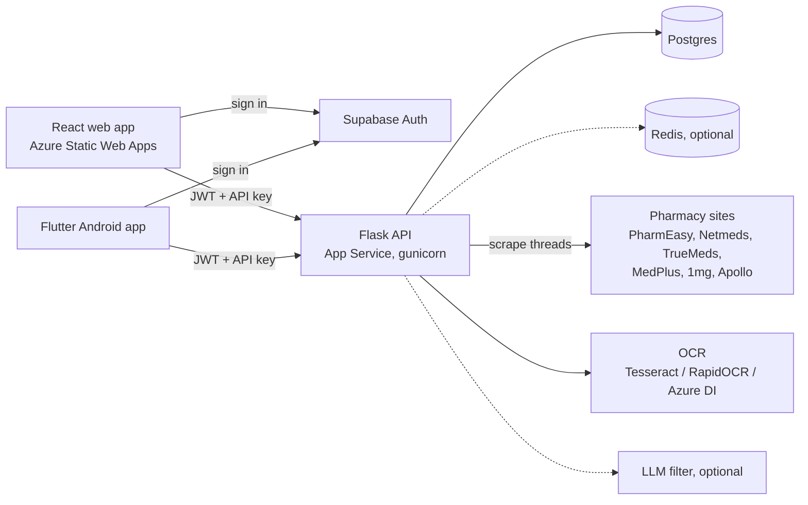

# Architecture

Three clients, one Flask API, one database. Price data comes from live pharmacy scrapes that run in the background.



## Auth

1. The client signs in with Supabase (email/password or Google).
2. It sends the Supabase access token to `POST /api/auth/supabase`.
3. The API verifies it (HS256 secret or Supabase JWKS), finds or creates the local `users` row by `supabase_id`, and returns a MedScan access + refresh JWT.
4. Every other call sends `Authorization: Bearer <medscan access token>`.

On top of that, production sets `MEDSCAN_CLIENT_API_KEYS`. Most `/api` routes then need `X-Medscan-Api-Key`. A request with no key but a **valid** MedScan JWT is let through (older APKs ship without a key); a bad JWT gets 401 so the client refreshes. `/api/health*`, `/api/auth/*` and `/api/buy` are exempt.

## Price search (background scrape)

Scraping six sites takes up to two minutes, so it never runs on a request thread.

```mermaid
sequenceDiagram
  participant C as Client
  participant A as API
  participant J as Scrape thread
  participant DB as Postgres
  C->>A: GET /api/search-medicine?query=dolo 650
  A->>DB: search_cache hit for today?
  alt cached
    A-->>C: 200 prices (cache_hit: true)
  else miss
    A->>DB: insert scrape_jobs row (pending)
    A->>J: start daemon thread
    A-->>C: 202 {pending, job_id, poll_after_ms}
    J->>J: httpx scrapers + Playwright scrapers
    J->>DB: write search_cache, prices, history; job = done
    loop every ~2s
      C->>A: GET /api/scrape-jobs/<job_id>
      A-->>C: {state: running | done | failed}
    end
    C->>A: GET /api/search-medicine?query=dolo 650 (again)
    A-->>C: 200 prices (cache_hit: true)
  end
```

Details worth knowing:

- Results are cached per normalised query **per day** (`search_cache.date_bucket`). Redis is used too when `REDIS_URL` is set; without it the DB is the cache.
- Two requests for the same query share one job. At most `SCRAPER_MAX_CONCURRENT_JOBS` (default 2) scrapes run at once per worker.
- Jobs and results live in the DB, so any gunicorn worker can answer a poll.
- A job that hasn't updated in `SCRAPER_TIMEOUT_SECS + 60` seconds is reported as failed (its worker probably died).
- Failed queries go on a retry queue; the scheduler retries them hourly.
- `/api/compare` is the same pipeline with ranking and savings added.

Scrapers: PharmEasy, Netmeds, TrueMeds and MedPlus use plain HTTP (TrueMeds/MedPlus first find the product URL via Google/DuckDuckGo). 1mg and Apollo need a real browser, so they use Playwright + Chromium with stealth.

## Prescriptions and lab reports

```
upload (image / PDF, 16 MB max)
  → PDF with embedded text? use it (PyMuPDF + pdfplumber)
  → else Azure Document Intelligence if configured
  → else local OCR (Tesseract, RapidOCR, OpenCV preprocessing)
  → prescriptions: medicine extraction (rules + catalog, optional LLM filter)
  → lab reports: biomarker parsing vs reference ranges
```

Medicine extraction is rule-based: Rx line patterns, a drug-name hint list, the seeded medicine catalog, and known fixed-dose combinations (e.g. Montelukast + Levocetirizine → Montair-LC). An LLM pass can be switched on to clean messy OCR (`MEDSCAN_LLM_MEDICINE_FILTER=1`).

## Background jobs (APScheduler)

Exactly one gunicorn worker runs the scheduler (a file lock decides which).

| Job | Every | Does |
| --- | --- | --- |
| `reminder_tick` | 15 min | Finds due reminders, advances `next_trigger`, sends email/SMS/in-app notifications |
| `cache_sweep` | 6 h | Deletes `search_cache` rows older than 30 days and `scrape_jobs` older than 1 day |
| `scraper_retry` | 1 h | Re-scrapes queries that failed earlier |

## Data model

| Table | Holds |
| --- | --- |
| `users` | Local user linked to Supabase by `supabase_id`; profile + preferences JSON |
| `search_history` | One row per search a signed-in user made |
| `search_cache` | Full search payload per query per day |
| `prices` | Raw price snapshots per pharmacy |
| `scrape_jobs` | Background scrape state |
| `medicine_catalog` | Seeded generic/brand catalog (from `app/data/medicine_catalog_seed.json`) |
| `prescriptions` | Uploaded prescriptions + extracted medicines |
| `lab_reports` | Uploaded lab reports + parsed biomarkers |
| `reminders` | Medicine schedules and `next_trigger` |
| `adherence_logs` | Doses taken / skipped |
| `in_app_notifications` | Notification feed |

## Hosting

| Piece | Where |
| --- | --- |
| API | Azure App Service `medscan-api`, Docker image from ACR `acrmedscan`, gunicorn 2 workers × 4 threads |
| Web | Azure Static Web Apps `swa-medscan` |
| APK | Built in CI, served from the web app at `/downloads/medmx-android.apk` |
| DB | Azure Postgres Flexible Server `pg-medscan` |
| Auth | Supabase |

See [azure-deployment.md](azure-deployment.md) for the full setup.
