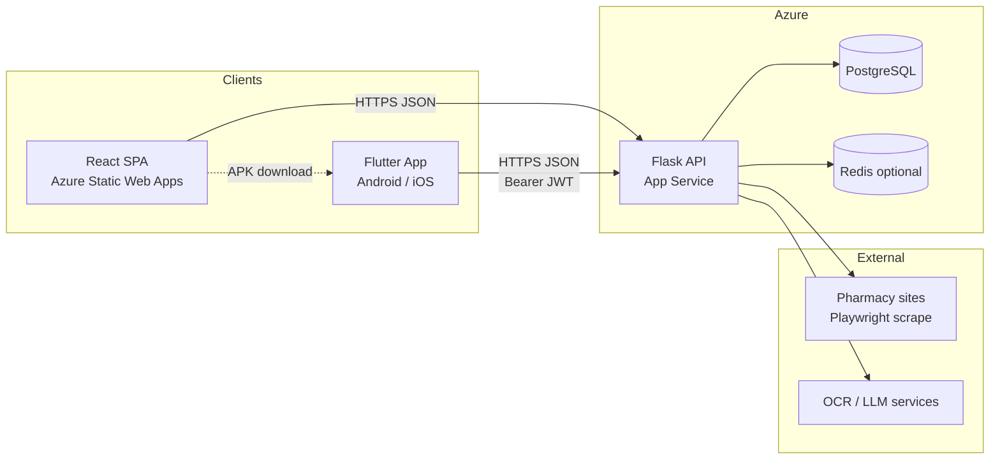
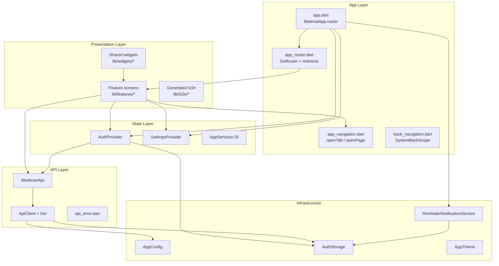
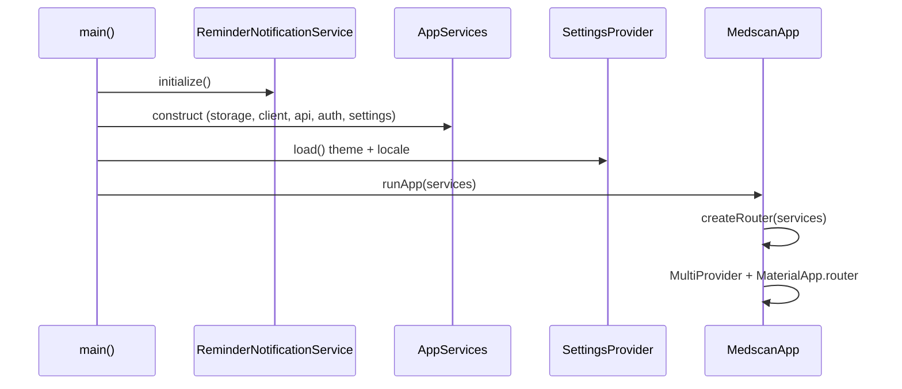
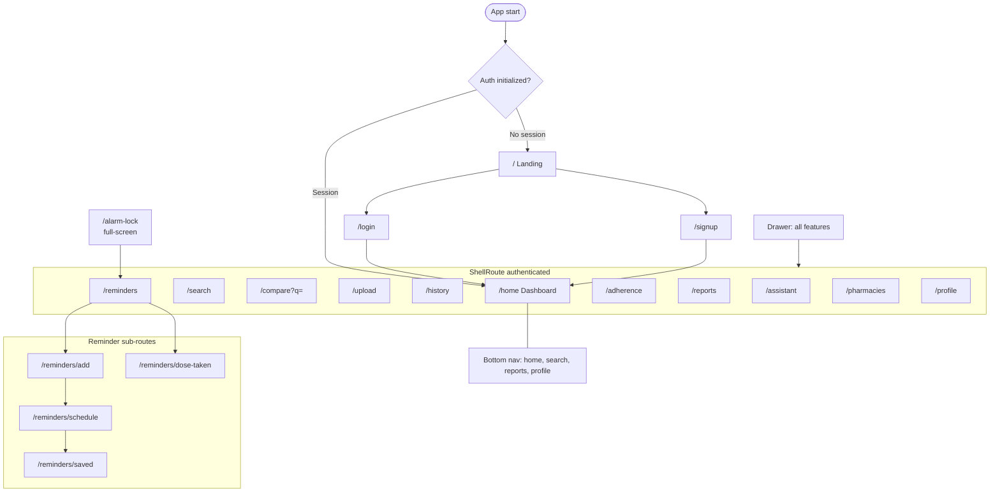
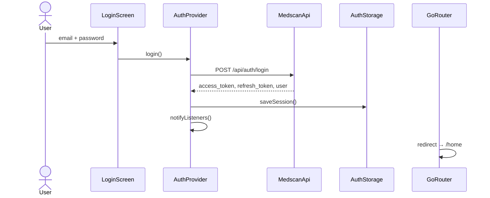
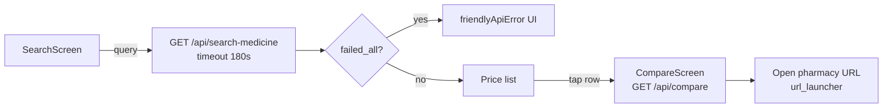
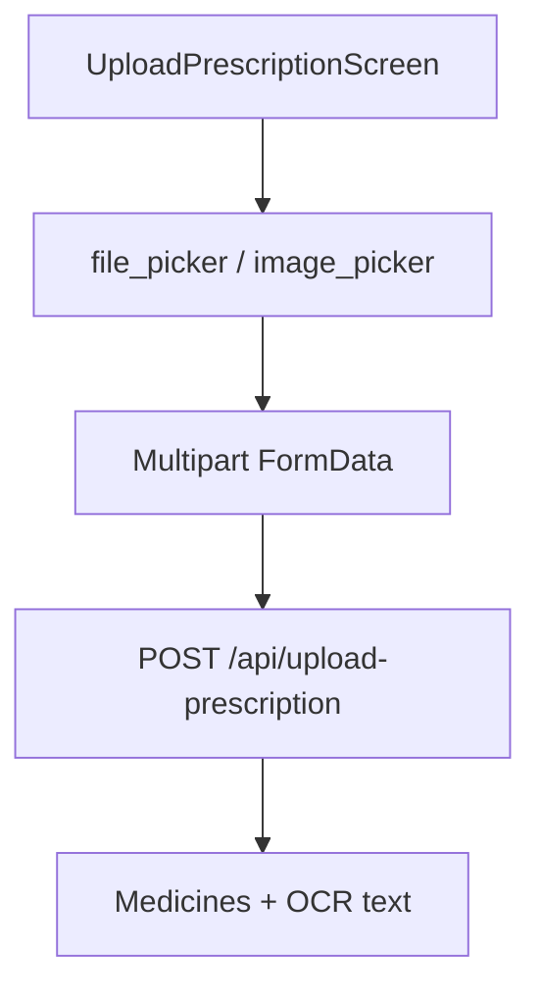
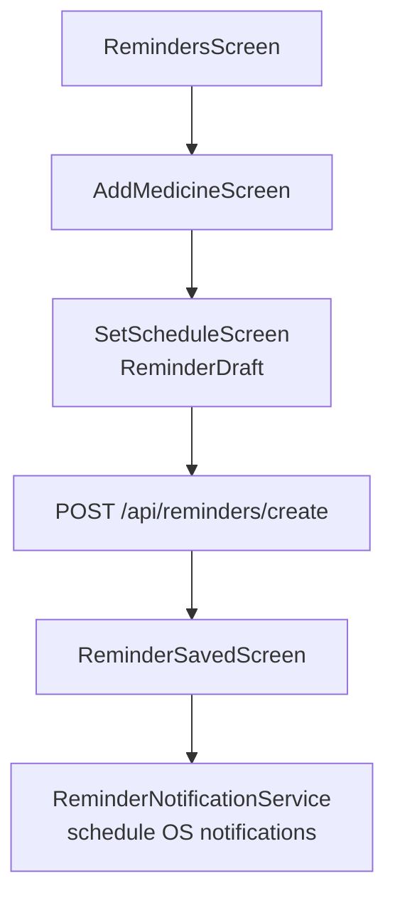
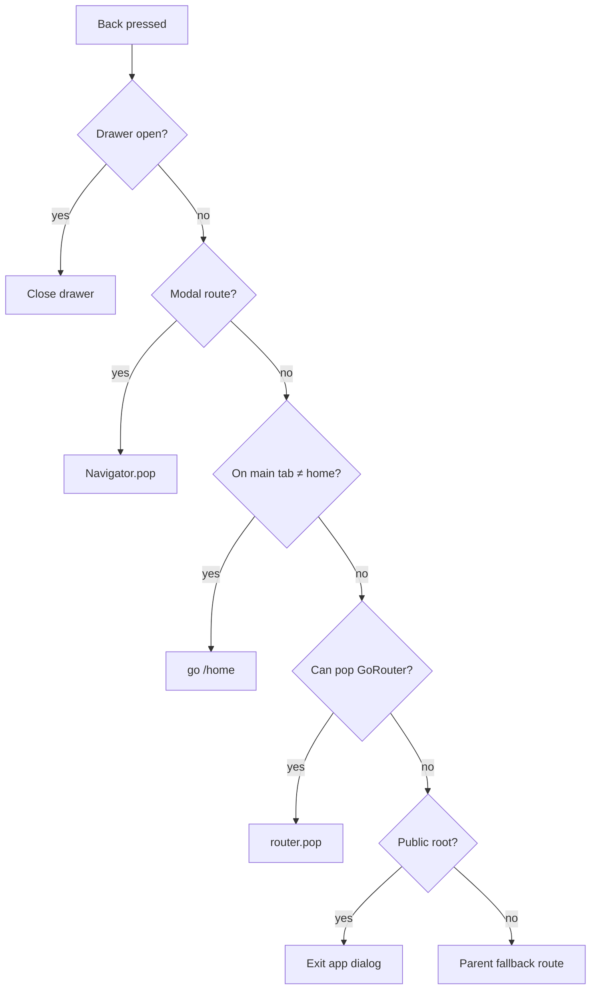

# MedMx LABS — Flutter Mobile App

Cross-platform mobile client for the **MedScan** backend (Flask API on Azure or local). It mirrors the React web app: JWT auth, live pharmacy price scraping, prescription OCR, medicine history, reminders with local alarms, adherence tracking, lab report analysis, AI assistant, and nearby pharmacies.

| | |
|---|---|
| **Package** | `medscan_mobile` |
| **Version** | `1.0.0+1` |
| **Flutter SDK** | `^3.11.5` |
| **Backend** | Same API as `medscan/frontend` and `medscan/backend` |
| **Production API** | `https://medscan-api.azurewebsites.net` |

---

## Table of contents

1. [Overview](#overview)
2. [System context](#system-context)
3. [Architecture](#architecture)
4. [Navigation & routes](#navigation--routes)
5. [User flows](#user-flows)
6. [State management](#state-management)
7. [API layer](#api-layer)
8. [Localization & theming](#localization--theming)
9. [Notifications & alarms](#notifications--alarms)
10. [Project structure](#project-structure)
11. [Tech stack](#tech-stack)
12. [Prerequisites](#prerequisites)
13. [Configure API URL](#configure-api-url)
14. [Run (development)](#run-development)
15. [Build & release](#build--release)
16. [Website APK download](#website-apk-download)
17. [Feature → API map](#feature--api-map)
18. [Android permissions](#android-permissions)
19. [Troubleshooting](#troubleshooting)
20. [Related documentation](#related-documentation)

---

## Overview

The app is organized as a **feature-first** Flutter project with a thin **core** layer (HTTP, config, theme, navigation helpers) and **Provider** for global state. **go_router** handles declarative routing, auth redirects, and a **ShellRoute** for the authenticated shell (bottom nav + drawer).

High-level capabilities:

- **Auth** — Email/password login and signup; JWT stored in `SharedPreferences`. (Web uses Supabase Auth exclusively; mobile still uses legacy `/api/auth/login` and `/api/auth/register` endpoints.)
- **Dashboard** — Stats, refill alerts, quick actions.
- **Medicines** — Search and compare prices across Indian pharmacies (long-running scrape, up to 180s).
- **Prescriptions** — Image/PDF upload → OCR + medicine extraction.
- **History** — Paginated search/upload history.
- **Reminders** — CRUD on server + **local scheduled notifications** (exact alarms on Android).
- **Adherence** — Dose logging and charts.
- **Lab reports** — Upload and AI analysis.
- **AI assistant** — Chatbot endpoint.
- **Nearby pharmacies** — GPS + radius search.
- **Profile** — Settings, theme, language, reset data.
- **UX** — Light / dark / system theme; 6 Indian languages; Android back stack with exit confirmation.

---

## System context

How the mobile app fits in the MedScan monorepo:



---

## Architecture

### Layered design



### Composition root (`main.dart` → `app.dart`)



| Component | Responsibility |
|-----------|----------------|
| `AppServices` | Single composition root: `AuthStorage`, `ApiClient`, `MedscanApi`, `AuthProvider`, `SettingsProvider` |
| `AuthProvider` | Session bootstrap, login/register/logout, `refreshListenable` for router |
| `SettingsProvider` | `ThemeMode` + `Locale`, persisted in `SharedPreferences` |
| `ApiClient` | Dio instance, JWT interceptor, 401 handling, response unwrap |
| `MedscanApi` | Typed methods for each REST endpoint |
| `GoRouter` | Auth guard, public vs shell routes, nested reminder routes |
| `AlarmGuard` | Wraps app to handle notification tap → route |
| `SystemBackScope` | Android back / gesture: drawer → pop → tab home → exit dialog |

---

## Navigation & routes

### Route map



### Auth redirect rules (`app_router.dart`)

| Condition | Redirect |
|-----------|----------|
| Not initialized | Wait (no redirect) |
| Guest on protected route | `/` (landing) |
| Logged in on `/`, `/login`, `/signup` | `/home` |
| `/alarm-lock` | Allowed when authenticated |

### Navigation helpers (`app_navigation.dart`)

| Method | Use when | Router call |
|--------|----------|-------------|
| `context.openTab(path)` | Bottom nav, drawer tab targets | `go(path)` — replaces shell branch |
| `context.openPage(path)` | Stack screens (upload, reminders, compare) | `push(path)` unless path is a main tab |
| `navigateBack(context)` | App bar back | Same as system back via `handleAppBack` |

### Shell UI

- **Bottom navigation** (4 tabs): `/home`, `/search`, `/reports`, `/profile`
- **FAB**: Opens `/upload` (prescription)
- **Drawer**: Overview, search, upload, history, reminders, adherence, lab reports, pharmacies, assistant
- **Hidden bottom nav** on `/upload`, `/assistant`, `/compare` (full-width flows)

---

## User flows

### Authentication



Signup: `POST /api/auth/register` → automatic `login()`.

Logout: clears storage, cancels all local reminder notifications, redirects to landing.

### Medicine search → compare



### Prescription upload



### Reminder creation (server + local alarms)



### Notification tap → app

```mermaid
flowchart TD
  N[OS notification] --> G[AlarmGuard / onReminderOpened]
  G --> S{Strict alarm mode?}
  S -->|yes| L[/alarm-lock AlarmLockScreen]
  S -->|no| R[/reminders]
  L --> Mark[Mark dose / dismiss]
```

### Android back button



Blocked on `/alarm-lock` (must use on-screen actions).

---

## State management

| State | Type | Persistence | Consumers |
|-------|------|-------------|-----------|
| Auth session | `AuthProvider` (`ChangeNotifier`) | `AuthStorage` → `SharedPreferences` | Router, all authenticated screens |
| Theme & locale | `SettingsProvider` (`ChangeNotifier`) | `SharedPreferences` | `MaterialApp`, profile pickers |
| Screen data | `StatefulWidget` local state | — | Per feature (dashboard, search, etc.) |
| Reminder draft | `ReminderDraft` model passed via `extra` | — | add → schedule → saved flow |

**Provider tree** (in `app.dart`):

```
MultiProvider
├── AppServices (value)
├── AuthProvider (ChangeNotifier)
├── SettingsProvider (ChangeNotifier)
├── MedscanApi (value)
└── ApiClient (value)
```

Router uses `refreshListenable: services.auth` so redirects run after login/logout.

---

## API layer

### Configuration (`lib/core/config.dart`)

| Constant | Default | Notes |
|----------|---------|-------|
| `apiBaseUrl` | `http://10.0.2.2:5000` | Override with `--dart-define=API_BASE_URL=...` |
| `defaultTimeout` | 30s | Most endpoints |
| `scrapeTimeout` | 180s | Search, compare, prescription upload |

### HTTP client behavior

- **Request**: Attaches `Authorization: Bearer <token>` unless `extra: { skipAuth: true }`.
- **Response**: Unwraps `{ "status": "success", "data": ... }` via `ApiClient.unwrap()`.
- **401**: Clears session and retries once without token (forces re-login on protected routes).
- **Errors**: `ApiClient.errorMessage()` + `friendlyApiError()` for user-facing hints (timeouts, wrong IP).

### Auth storage (`lib/core/storage/auth_storage.dart`)

Stores: `access_token`, `refresh_token` (optional), serialized `user` JSON.

---

## Localization & theming

### Languages (ARB → codegen)

| Code | Language |
|------|----------|
| `en` | English (template) |
| `hi` | Hindi |
| `ta` | Tamil |
| `te` | Telugu |
| `kn` | Kannada |
| `mr` | Marathi |

- ARB files: `lib/l10n/app_*.arb`
- Config: `l10n.yaml`
- Access: `context.l10n` via `lib/core/l10n_ext.dart`
- Profile → language picker (`showLanguagePicker`)

### Theme

- `AppTheme.light()` / `AppTheme.dark()` — teal / lime / navy brand palette (`lib/core/theme.dart`)
- Modes: light, dark, system (`SettingsProvider`)
- Profile → theme picker (`showThemePicker`)

---

## Notifications & alarms

`ReminderNotificationService` (singleton):

- Initializes timezone (`Asia/Kolkata` fallback)
- Android channels: `medmx_reminders`, `medmx_alarm` (high priority + vibration)
- Schedules recurring notifications per reminder time slot
- Persists scheduled IDs; reschedules after boot (`RECEIVE_BOOT_COMPLETED`)
- **Strict mode** (`ReminderAlarmPrefs`): full-screen `/alarm-lock` when notification opened

Integrated in `main.dart` (init) and `app.dart` (`onReminderOpened` → `GoRouter`).

---

## Project structure

```
mobile/
├── android/                 # Android Gradle project, manifest, permissions
├── ios/                     # iOS Xcode project
├── assets/images/           # MedMx logos
├── lib/
│   ├── main.dart            # Entry: notifications init, settings load
│   ├── app.dart             # MaterialApp.router, providers, AlarmGuard
│   ├── core/
│   │   ├── config.dart              # API_BASE_URL, timeouts
│   │   ├── theme.dart               # Colors, ThemeData, decorations
│   │   ├── api/
│   │   │   ├── api_client.dart      # Dio + interceptors
│   │   │   └── medscan_api.dart     # REST methods
│   │   ├── storage/
│   │   │   └── auth_storage.dart
│   │   ├── notifications/
│   │   │   ├── reminder_notification_service.dart
│   │   │   ├── alarm_guard.dart
│   │   │   ├── alarm_vibration.dart
│   │   │   └── reminder_alarm_prefs.dart
│   │   ├── app_navigation.dart      # openTab / openPage
│   │   ├── back_navigation.dart     # SystemBackScope, exit dialog
│   │   ├── api_error.dart
│   │   ├── app_helpers.dart
│   │   ├── l10n_ext.dart
│   │   └── local_store.dart
│   ├── providers/
│   │   ├── auth_provider.dart       # AuthProvider + AppServices
│   │   └── settings_provider.dart
│   ├── router/
│   │   └── app_router.dart          # GoRouter routes + redirects
│   ├── features/
│   │   ├── landing/                 # Public landing + logo
│   │   ├── auth/                    # login, signup
│   │   ├── home/                    # ShellScreen (nav + drawer)
│   │   ├── dashboard/
│   │   ├── search/
│   │   ├── compare/
│   │   ├── prescription/
│   │   ├── history/
│   │   ├── reminders/               # + models/, alarm_lock, draft flow
│   │   ├── adherence/
│   │   ├── reports/
│   │   ├── assistant/
│   │   ├── pharmacies/
│   │   └── profile/
│   ├── widgets/
│   │   ├── app_drawer.dart
│   │   ├── ui_components.dart       # PageShell, cards, buttons
│   │   ├── common_widgets.dart
│   │   ├── settings_pickers.dart
│   │   └── shell_scope.dart         # Drawer control from child screens
│   └── l10n/                        # ARB + generated localizations
├── l10n.yaml
├── pubspec.yaml
└── README.md
```

---

## Tech stack

| Category | Packages |
|----------|----------|
| **UI** | `flutter`, `google_fonts`, Material 3 |
| **Navigation** | `go_router` |
| **State** | `provider` |
| **HTTP** | `dio` |
| **Storage** | `shared_preferences` |
| **i18n** | `flutter_localizations`, ARB codegen |
| **Media / files** | `image_picker`, `file_picker` |
| **Location** | `geolocator` |
| **Links** | `url_launcher` |
| **Notifications** | `flutter_local_notifications`, `timezone`, `flutter_timezone`, `vibration` |
| **Utilities** | `intl` |

---

## Prerequisites

- **Flutter 3.11+** — run `flutter doctor` and fix Android/iOS toolchain issues
- **MedScan backend** running locally or on Azure
- **Android Studio** (Android) or **Xcode** (iOS, macOS only)
- For **physical device** testing: PC and phone on the same Wi‑Fi (local API)

---

## Configure API URL

Set at **build/run time** with `--dart-define=API_BASE_URL=<url>` (see `lib/core/config.dart`).

| Environment | `API_BASE_URL` |
|-------------|----------------|
| Android emulator (backend on host) | Default `http://10.0.2.2:5000` — no flag needed |
| iOS simulator (backend on host) | `http://127.0.0.1:5000` |
| Physical device (same Wi‑Fi) | `http://<YOUR_PC_IPV4>:5000` |
| **Production** | `https://medscan-api.azurewebsites.net` |

**Find your PC IP (Windows):**

```powershell
ipconfig
```

Use the **IPv4** on your active Wi‑Fi adapter (e.g. `192.168.8.182`). Avoid stale VPN/Tailscale IPs that no longer respond.

**Verify backend before testing on a phone:**

```powershell
curl http://127.0.0.1:5000/health
curl http://YOUR_PC_IP:5000/health
```

Both should return JSON like `{"status":"ok",...}`.

**Debug cleartext HTTP (local only):** `android/app/src/debug/AndroidManifest.xml` sets `usesCleartextTraffic=true` for non-HTTPS dev URLs.

**CORS:** Backend `CORS_ORIGINS` should allow your origins or be unset for development.

---

## Run (development)

```bash
cd mobile
flutter pub get
flutter run
```

**Examples:**

```bash
# Production API on device
flutter run --dart-define=API_BASE_URL=https://medscan-api.azurewebsites.net

# Physical device → laptop backend
flutter run --dart-define=API_BASE_URL=http://192.168.8.182:5000
```

**Codegen** (after editing ARB files):

```bash
flutter gen-l10n
# or
flutter pub get   # if generate: true in pubspec
```

**Analyze:**

```bash
flutter analyze
```

---

## Build & release

Always set production API for store/APK builds:

```bash
cd mobile

# Android APK (side-load / website download)
flutter build apk --release \
  --dart-define=API_BASE_URL=https://medscan-api.azurewebsites.net

# Android App Bundle (Play Store)
flutter build appbundle --release \
  --dart-define=API_BASE_URL=https://medscan-api.azurewebsites.net

# iOS (macOS only)
flutter build ios --release \
  --dart-define=API_BASE_URL=https://medscan-api.azurewebsites.net
```

**Output paths:**

| Artifact | Path |
|----------|------|
| Release APK | `build/app/outputs/flutter-apk/app-release.apk` |
| App Bundle | `build/app/outputs/bundle/release/app-release.aab` |

**Install APK on connected device:**

```bash
flutter install --release
```

---

## Website APK download

The React site hosts the same release APK for one-tap install:

1. Build APK (command above).
2. Copy into frontend static assets:

```bash
cd ../frontend
npm run copy:apk
```

3. Deploy frontend — users download `/downloads/medmx-android.apk`.

CI (`.github/workflows/deploy-frontend.yml`) builds the APK and copies it automatically before Azure Static Web Apps deploy.

---

## Feature → API map

| Screen / feature | Route(s) | API endpoint(s) |
|------------------|----------|-----------------|
| Login | `/login` | `POST /api/auth/login` |
| Signup | `/signup` | `POST /api/auth/register` |
| Dashboard | `/home` | `GET /api/dashboard`, `GET /api/refill/alerts` |
| Search | `/search` | `GET /api/search-medicine` |
| Compare | `/compare` | `GET /api/compare` |
| Upload prescription | `/upload` | `POST /api/upload-prescription` |
| History | `/history` | `GET /api/history` |
| Reminders | `/reminders/*` | `GET/POST/PATCH/DELETE /api/reminders/*` |
| Mark dose | `/reminders/dose-taken` | `POST /api/adherence/mark-dose` |
| Adherence | `/adherence` | `GET /api/adherence` |
| Lab reports | `/reports` | `POST /api/report-analysis` |
| AI assistant | `/assistant` | `POST /api/chatbot` |
| Nearby pharmacies | `/pharmacies` | `GET /api/pharmacies/nearby` |
| Profile | `/profile` | `GET/PATCH /api/profile/*`, `POST /api/profile/reset-data` |

---

## Android permissions

Declared in `android/app/src/main/AndroidManifest.xml`:

| Permission | Purpose |
|------------|---------|
| `INTERNET` | API calls |
| `ACCESS_FINE/COARSE_LOCATION` | Nearby pharmacies |
| `POST_NOTIFICATIONS` | Reminder alerts (Android 13+) |
| `SCHEDULE_EXACT_ALARM` / `USE_EXACT_ALARM` | On-time medicine alarms |
| `RECEIVE_BOOT_COMPLETED` | Reschedule after reboot |
| `VIBRATE` | Alarm vibration pattern |
| `WAKE_LOCK` | Reliable notification delivery |
| `USE_FULL_SCREEN_INTENT` | Strict alarm lock screen |

---

## Troubleshooting

| Issue | What to check |
|-------|----------------|
| Connection timeout on phone | `API_BASE_URL` must be PC LAN IP, not `localhost` or old VPN IP; backend listening on `0.0.0.0:5000` |
| Emulator cannot reach API | Android: `10.0.2.2`; iOS: `127.0.0.1` |
| 401 after idle | Token cleared by interceptor — log in again |
| Search/compare hangs | Normal up to **180s** (live scraping); wait or check backend logs |
| Notifications not firing | Grant notification + exact alarm permissions; disable battery optimization for MedMx |
| Back button exits immediately | Ensure routes use `SystemBackScope` (see `app_router.dart`) |
| `flutter analyze` warnings | Run `flutter analyze`; fix unused imports / async context issues |

---

## Related documentation

| Document | Location |
|----------|----------|
| Monorepo overview | [`../README.md`](../README.md) |
| Azure deployment | [`../docs/azure-deployment.md`](../docs/azure-deployment.md) |
| API integration notes | [`../docs/integration-report.md`](../docs/integration-report.md) |
| Web frontend | [`../frontend/`](../frontend/) |
| Flask backend | [`../backend/`](../backend/) |

---

## License & disclaimer

Part of the MedScan / MedMx LABS project. App content is **informational only** — not a substitute for professional medical advice. Always confirm medicines and dosages with a qualified healthcare provider.
